  

---

  

---

  

---

  

 

## ◈ GITHUB ACTIVITY

  <!-- GitHub Statistics -->
  

  <!-- GitHub Streak -->
  

   

  <!-- Contribution Activity Graph -->
  

---

## 📫 LET'S CONNECT

I'm always open to collaborating on AI and Data Science projects, exploring new technologies, and connecting with fellow developers.

&nbsp;

&nbsp;

  

**"Building intelligence, one project at a time."**

