 

---

  

---

## 🛠️ TECH STACK & TOOLS

| Category | Technologies |
|:---|:---|
| **Programming Languages** | Python · Java · SQL |
| **Data Science & Analytics** | Pandas · NumPy · Matplotlib · Seaborn · Plotly · Power BI |
| **AI & Machine Learning** | Scikit-learn · TensorFlow · LangChain |
| **Development Tools** | PyCharm · Google Colab · Jupyter Notebook · Streamlit |
| **Version Control** | Git · GitHub |
| **Databases** | MySQL |

---

## 🚀 FEATURED PROJECTS

### 🧠 Brain Tumor Detection & Explainable AI
[Repository](https://github.com/Sad3nwl/Brain-Tumor-Detection)

Deep Learning project for brain tumor classification using Transfer Learning with MobileNetV2, integrating Grad-CAM visualizations to improve model interpretability.

### 🤖 Arabic RAG Wikipedia
[Repository](https://github.com/Sad3nwl/arabic-rag-wikipedia)

An Arabic Retrieval-Augmented Generation application that retrieves information from Wikipedia articles and generates source-grounded answers using LangChain, ChromaDB, and Streamlit.

### 📊 CarInsight Dashboard
[Repository](https://github.com/Sad3nwl/CarInsight-Dashboard)

Interactive automotive data analytics dashboard built with Python, Pandas, Plotly, and Streamlit, featuring KPIs, dynamic filters, and data visualizations.

### 📰 News Classification using NLP
[Repository](https://github.com/Sad3nwl/-News-Classification-using-NLP)

NLP-based text classification system that categorizes news articles using TF-IDF feature extraction and Machine Learning algorithms.

### 💬 Arabic Sentiment Analysis
[Repository](https://github.com/Sad3nwl/arabic-sentiment-analysiss)

Arabic text sentiment classification using Natural Language Processing and Machine Learning to identify Positive, Negative, and Mixed reviews.

### 💊 Pharmacy Management System
[Repository](https://github.com/Sad3nwl/-Pharmacy-Management-System)

Java-based console application for managing pharmacy inventory and patient prescriptions, demonstrating Object-Oriented Programming concepts including encapsulation, inheritance, and polymorphism.

---

## 📊 GITHUB ACTIVITY

---

## 📫 LET'S CONNECT

I'm always open to collaborating on AI and Data Science projects, exploring new technologies, and connecting with fellow developers.

&nbsp;

&nbsp;

  

**"Building intelligence, one project at a time."**

